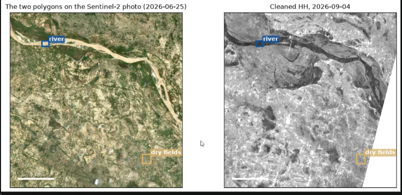

Flood case study:

Before, show river + dry land

Show change from Sept 4 (before) to Sept 28 (flood)

Show combined change view, with a line or two to explain how the physical environment and the water level can interact to give variable NISAR readings. By using a rule-based approach to process each change, we can estimate what was happining in different areas.

Glacier Collapse

In NISARs data, coherence measures how similar the ground's radar "fingerprint" is between two passes of a GUNW pair. Ground that was ripped up, buried, or flooded in between loses coherence (decorrelation), so a drop in coherence marks a place where something has changed. Using this, we can identify areas of greatest change as those most likely affected by the flood.
